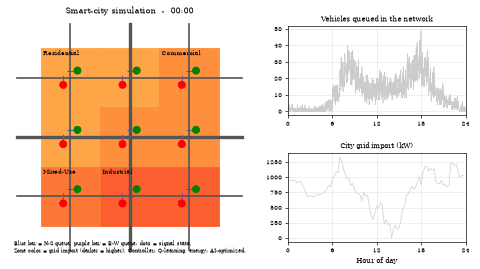

# AI-Driven Smart-City Traffic and Energy Optimization

A discrete-event simulation of a 3 x 3 city grid that compares traffic-signal controllers (fixed-time, rule-based actuated, and multi-agent Q-learning) and manages a four-zone electricity grid with a machine-learning load forecast, peak shaving, solar sharing, and traffic-adaptive street lighting. The results are played back in a 3D Unity city.

Built by Margaret Gonzalez for the Advanced Artificial Intelligence course in the Computer Science Graduate Program at Full Sail University. The IEEE-format report is in [`report/`](report/).



## Key results (mean of 5 simulated days)

| Measurement | Result |
|---|---|
| Average vehicle delay | fixed-time 42.63 s, rule-based 23.03 s, Q-learning 19.18 s (55.0 percent lower than fixed-time) |
| Grid import | 5.7 percent lower with the AI-optimized energy policy |
| Peak demand | 8.9 percent lower |
| Energy cost | 12.7 percent lower |
| Wasted solar energy | 98.6 percent lower |
| Street-lighting energy | 59.1 percent lower |
| Load forecaster (gradient boosting) | MAE 11.0 kW, MAPE 3.8 percent, R squared 0.996 |

## Skills demonstrated

Reinforcement learning (tabular Q-learning with a shared multi-agent policy), discrete-event simulation with SimPy, gradient-boosting forecasting with scikit-learn, optimization heuristics for energy dispatch, reproducible experiments with fixed seeds, automated validation tests with pytest, data visualization (figures, heatmaps, MP4 and GIF animation), and C# scripting for a data-driven Unity playback scene.

## Repository layout

| Folder | Contents |
|---|---|
| [`smart_city_project/`](smart_city_project/) | Python simulation, experiments, tests, notebook, and all outputs (see its README for step-by-step instructions) |
| [`smart_city_project/outputs/figures/`](smart_city_project/outputs/figures/) | Ten figures and heatmaps, plus animation frames |
| [`SmartCityUnity/`](SmartCityUnity/) | Unity C# scripts, exported simulation data, and `SmartCityPlayback.unitypackage` (see `UNITY_README.md`) |
| [`report/`](report/) | IEEE-format project report |

## Quick start

```
cd smart_city_project
pip install -r requirements.txt
python run_experiments.py --quick     # about 2 minutes
python -m pytest -v tests             # 14 validation tests
```

To view the 3D playback, create a Unity 2021.3 LTS or newer 3D project, import `SmartCityUnity/SmartCityPlayback.unitypackage`, choose the menu Smart City > Create Playback Scene, and press Play.
